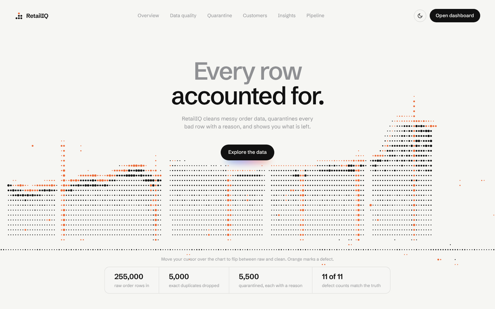
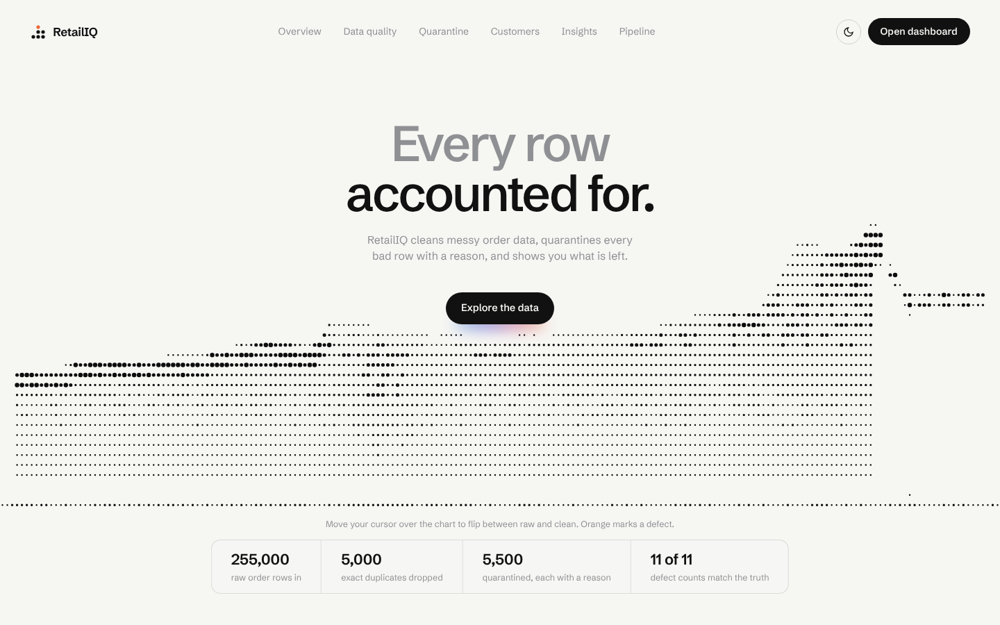
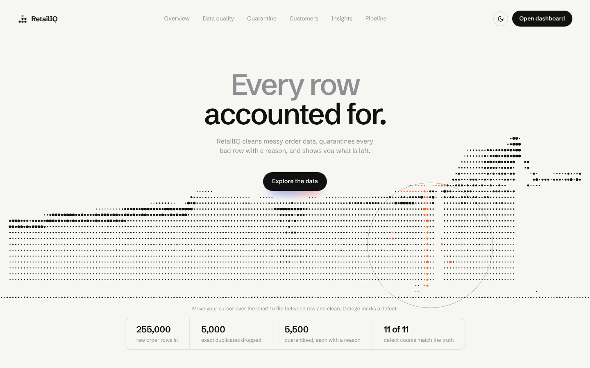
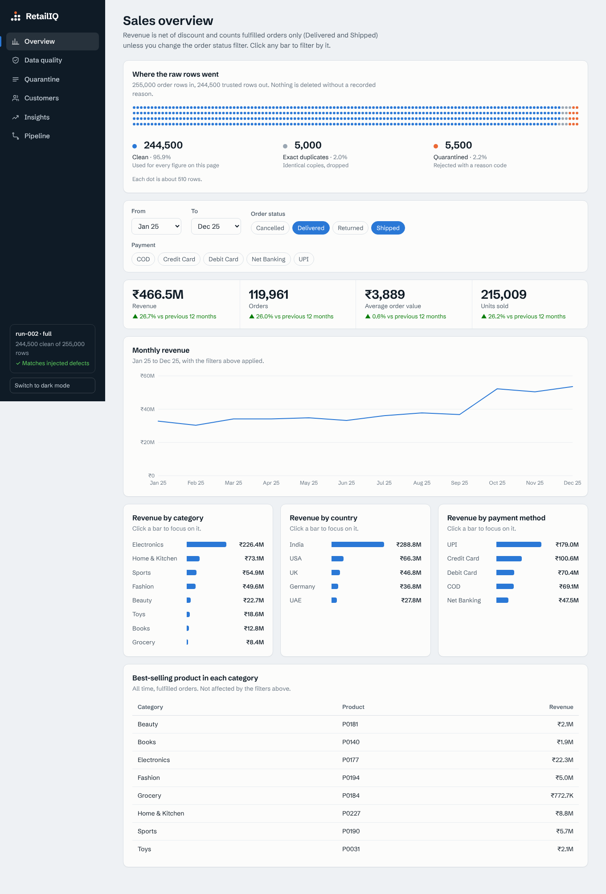

# RetailIQ

A data-quality pipeline and analytics dashboard for retail order data.
PySpark cleans 255,000 messy order rows, quarantines every rejected row with a reason, and a React
dashboard on Vercel lets you explore the result.

Built on the course project *From Raw Data to Insight: An End-to-End Big Data Analytics Pipeline*
(SRMIST, 21CSC314P). The five stages and the injected-defect validation come from that work; this
version makes the rules configurable, adds tests, new analytics and a deployable web app.



The landing page is a live LED dot-matrix chart of the real monthly revenue, drawn on a canvas every
frame. It starts as **raw** data (orange dots are defects: outlier spikes, missing-value gaps, a
duplicate ghost line, orphan rows), then each half of the screen dissolves dot by dot into the
**clean** series plus the 3-month forecast, and back, on a 20-second loop. Move the cursor over it to
open a lens that shows the opposite state. It respects `prefers-reduced-motion` (one static frame).

| Raw | Clean | Lens |
|---|---|---|
|  |  |  |



## What it does

| Page | What you can do |
|---|---|
| Home (`/`) | The dot-matrix hero above, with the run's headline numbers. |
| Overview (`/overview`) | Filter by month, status, payment, country and category (click any bar). KPIs compare with the previous period. |
| Data quality | Row reconciliation (255,000 − 5,000 − 5,500 = 244,500), a before/after scorecard on five quality dimensions, and every rule checked against the number of defects injected. |
| Quarantine | Search, filter and download the 5,500 rejected rows, shown as raw text with the rule that stopped them. |
| Customers | RFM segments, recency-frequency heatmap, revenue by city and tier. |
| Insights | 3-month forecast with a 90% range (hold-out error reported), daily anomaly scan, auto-written findings. |
| Pipeline | Stage timings, Parquet vs CSV benchmark, rule list, run history, API reference. |

## Architecture

```
generate_data.py ─► data/raw ─► PySpark pipeline ─► public/data/*.json  ─► React dashboard (static)
  (seeded, known                (ingest, clean,     api/_data/*.json    ─► /api/* serverless functions
   injected defects)             process, store,
                                 export)
```

Vercel serves static files and short serverless functions; it cannot run Spark. So Spark runs
**offline** and exports small JSON files (about 1.2 MB in total) that the site reads. To refresh the site: re-run the
pipeline, commit the JSON, push.

## Run locally

```bash
pip install -r requirements.txt          # needs Java 17+ for Spark
python pipeline/generate_data.py         # seeded raw files (about 17 MB, git-ignored)
python pipeline/run_pipeline.py          # about 1 minute on 2 cores
python -m pytest -q tests                # 22 tests
npm install && npm run dev               # http://localhost:5173, /api works in dev too
```

`python pipeline/run_pipeline.py --sample 0.2` runs on 20% of the rows for quick development
(it logs a run but does not overwrite the site data).

## Deploy to Vercel

1. Push this folder to a GitHub repository. Commit `public/data/` and `api/_data/` (about 1.2 MB, already generated). `data/` is git-ignored.
2. In Vercel choose **Add New, Project**, import the repository. Framework preset: **Vite**. No environment variables are needed.
3. Deploy. `vercel.json` already sets the build command, the SPA rewrites and bundles `api/_data` into the functions.

Or with the CLI: `npm i -g vercel && vercel --prod`.

## Configuring the cleaning rules

Rules live in `pipeline/rules.yaml`, not in Spark code. They run top to bottom and the first failing
rule becomes the reject reason, so each row is counted once. Set `enabled: false` on a rule, change a
threshold (`multiplier`, `min_quantity`) or reorder them, then re-run. A unit test proves that
disabling a rule changes the result.

## How correctness is checked

- `tests/test_clean_rules.py`: 17 unit tests on hand-written rows (date formats, each rule, duplicates, priority order, the outlier false-positive case, disabling a rule).
- `tests/test_ground_truth.py`: after a full run, every detected count must equal the number the generator injected, row accounting must balance, the cube total must equal the KPI, and the cleaned data must pass independent re-checks.

## Honest limits

- **The data is synthetic.** That is deliberate (defect counts are known exactly), but real data has subtler problems. Segments on this data reflect random assignment, not behaviour.
- **The forecast is small by design:** trend plus a festive-season dummy on 24 monthly points, validated on a 3-month hold-out.
- **The site is a snapshot.** It shows the last pipeline run; it does not run Spark on request.
- **Found, not injected:** about 9,600 orders are dated before the customer signed up. They are flagged as an advisory check, not rejected.

## Layout

```
pipeline/   rules.yaml, run_pipeline.py, retailiq/ (ingest, clean, quality, process, analytics, storage, export)
api/        quarantine.js, summary.js, health.js, _data/ (bundled JSON)
src/        React app (pages/Home.tsx is the canvas hero; charts.tsx, data.ts, styles.css)
public/data meta.json, analytics.json, cube.json
tests/      pytest suite
```
