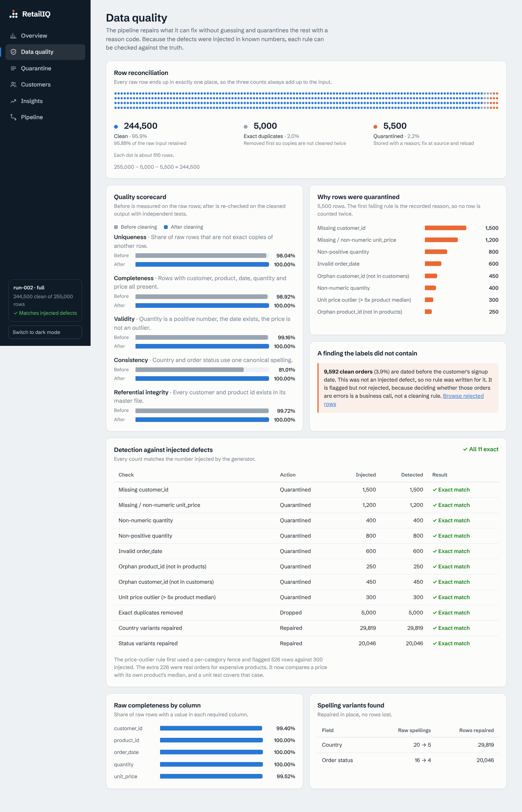

# RetailIQ

**A quarantine-based big data analytics pipeline with ground-truth validation for retail transaction data.**

RetailIQ cleans 255,000 messy retail order rows with PySpark, never deletes a row without a recorded
reason, and checks every cleaning rule against defects whose true counts are known. The result is
explored in a React dashboard deployed on Vercel.

[Research paper (PDF)](docs/RetailIQ_Research_Paper.pdf) · [Upload your own data](#upload-your-own-data) · [Deployment](#deployment) · [Pipeline](#how-it-works) · [Testing](#testing-and-validation)


## Highlights

| | |
|---|---|
| **255,000 → 244,500** | Raw rows in, trusted rows out (95.88% retained) |
| **11 / 11** | Defect classes detected with counts exactly equal to the injected counts |
| **5,500** | Unrecoverable rows quarantined, each with a reason code |
| **50,000** | Spelling variants repaired in place (29,819 country, 20,046 status) |
| **81% → 100%** | Consistency score before and after cleaning |
| **30** | Automated tests (17 cleaning unit, 5 integration, 8 upload-validation) |

## Design principles

1. **Text-first ingestion.** Every order field is read as a string so type inference cannot hide a defect. Typing happens explicitly in the cleaning stage, with `try_cast` and `try_to_date` so bad values become NULL instead of crashing Spark.
2. **Quarantine, not delete.** A row that cannot be repaired without guessing is written to a quarantine store with a reason code. Nothing is imputed and nothing disappears silently.
3. **Measure, do not assume.** The data is synthetic, so the number of injected defects is known. Each rule is verified against that number.

Every run satisfies the reconciliation identity `N_raw = N_duplicates + N_quarantined + N_clean`
(255,000 = 5,000 + 5,500 + 244,500).

## How it works

```
generate_data.py ─► data/raw ─► PySpark pipeline ─► public/data/*.json  ─► React dashboard (static)
  (seeded, known                (ingest, clean,     api/_data/*.json    ─► /api/* serverless functions
   injected defects)             process, store,
                                 export)
```

| Stage | What it does |
|---|---|
| 1. Ingestion | Reads `orders.csv`, `customers.json`, `products.csv` as text; PERMISSIVE mode; null and blank profiling |
| 2. Cleaning | Deduplicates, standardises spellings and dates, types safely, applies ordered rules, quarantines rejects |
| 3. Processing | Broadcast joins, KPI and aggregate tables, window-function ranking, RFM customer segments |
| 4. Storage | Month-partitioned Snappy Parquet, quarantine store, storage benchmark |
| 5. Export | Compact JSON consumed by the web app and serverless API |

Vercel cannot run Spark, so the pipeline runs **offline** and exports about 1.2 MB of JSON that the
site reads. To refresh the site: re-run the pipeline, commit the JSON, push.

### Injected defects and results

| Defect | Injected | Detected | Treatment |
|---|---:|---:|---|
| Exact duplicate rows | 5,000 | 5,000 | Dropped |
| Missing `customer_id` | 1,500 | 1,500 | Quarantined |
| Missing `unit_price` | 1,200 | 1,200 | Quarantined |
| Quantity zero or negative | 800 | 800 | Quarantined |
| Quantity as text | 400 | 400 | Quarantined |
| Price 50x to 250x too high | 300 | 300 | Quarantined |
| Impossible date | 600 | 600 | Quarantined |
| Orphan `customer_id` | 450 | 450 | Quarantined |
| Orphan `product_id` | 250 | 250 | Quarantined |
| Country spelling variants | 29,819 | 29,819 | Repaired |
| Status casing variants | 20,046 | 20,046 | Repaired |

### A rule that was wrong

The first price-outlier rule used a per-category Tukey fence and flagged 526 rows against 300 injected.
The extra 226 were genuine orders for expensive products. It was replaced with a per-product test
(price above 5x that product's median), which flags exactly 300. The error was found only because the
true count was known. See Section 6.2 of the paper.

## Dashboard

| Page | Purpose |
|---|---|
| Home (`/`) | Live dot-matrix chart of monthly revenue that dissolves from raw data (defects in orange) to clean data plus forecast. Respects `prefers-reduced-motion`. |
| Overview | KPIs with previous-period comparison; filter by month, status, payment, country and category |
| Data quality | Row reconciliation, before/after scorecard on five dimensions, detection against injected defects |
| Quarantine | Search, filter and download the 5,500 rejected rows as raw text with the rule that stopped them |
| Customers | RFM segments, recency-frequency heatmap, revenue by city and loyalty tier |
| Insights | 3-month forecast with a 90% range, daily anomaly scan, auto-written findings |
| Pipeline | Stage timings, Parquet vs CSV benchmark, rule list, run history, API reference |
| Upload data | Send your own orders, customers and products; the backend runs the Spark pipeline and the dashboard then shows your results |

Each panel carries a short note explaining what the data is and why it helps in that visualisation
(`src/explain.ts`).

| Overview | Data quality |
|---|---|
|  |  |

## Getting started

**Dashboard only** (uses the JSON already in the repo, no Java needed):

```bash
npm install
npm run dev          # http://localhost:5173, /api works in dev too
```

**Full pipeline** (needs Python 3.10+ and Java 17+ for Spark):

```bash
pip install -r requirements.txt
python pipeline/generate_data.py         # seeded raw files, about 17 MB, git-ignored
python pipeline/run_pipeline.py          # about 1 minute on 2 cores
python -m pytest -q tests                # 30 tests
```

`python pipeline/run_pipeline.py --sample 0.2` runs on 20% of the rows for quick development. It logs
a run but does not overwrite the site data unless you also pass `--export`.

## Upload your own data

Vercel cannot run Spark, so uploads go to a small **FastAPI backend** that runs the same pipeline on a
machine with Java. Each upload is an isolated job, so it never touches the demo data.

```
Browser (Vercel) ──POST /api/upload──► FastAPI ──validate + normalise──► run_pipeline.py --workdir jobs/<id>
        ▲                                                                       │
        └──── poll /api/jobs/<id>, then read /api/jobs/<id>/data/*.json ◄───────┘
```

```bash
pip install -r backend/requirements.txt          # needs Java 17+
uvicorn backend.app:app --port 8000              # terminal 1
npm run dev                                      # terminal 2, then open Upload data in the sidebar
```

Required files (the page offers templates):

| File | Columns |
|---|---|
| orders (CSV) | `order_id, customer_id, product_id, order_date, quantity, unit_price, discount_pct, country, payment_method, status` |
| customers (JSON lines or CSV) | `customer_id, city, tier, signup_date` |
| products (CSV) | `product_id, category` (optional `product_name, list_price`) |

Header names are matched ignoring case and column order. Rows that break a rule are quarantined with a
reason, exactly as for the demo data. At least 8 months of orders are needed for the forecast, and the
country map and date formats in `pipeline/rules.yaml` may need extending for your data. Uploaded data
has no injected defects, so the "detection against injected defects" check is not applicable to it.

**Backend settings** (environment variables): `RETAILIQ_MAX_UPLOAD_MB` (50), `RETAILIQ_JOB_TTL_HOURS` (24),
`RETAILIQ_JOB_TIMEOUT_S` (900), `RETAILIQ_MAX_QUEUE` (4), `RETAILIQ_CORS_ORIGINS` (`*`, set it to your site
URL in production), `RETAILIQ_JOBS_DIR`. One pipeline runs at a time; extra uploads wait in a queue.

**Hosting it:** build `Dockerfile.backend` and run it on Render, Railway, Fly.io or a VPS with about 3 GB of
RAM. Then set `VITE_BACKEND_URL` to its address in the Vercel project settings and redeploy. Without a
backend the site still works as a static snapshot; the Upload page just reports that the backend is offline.
The backend has no authentication, so put it behind your own gateway before exposing it widely.

## Configuring the cleaning rules

Rules live in `pipeline/rules.yaml`, not in Spark code. They run top to bottom and the first failing
rule becomes the reject reason, so each row is counted once. Set `enabled: false` on a rule, change a
threshold (`multiplier`, `min_quantity`) or reorder them, then re-run. A unit test proves that
disabling a rule changes the result.

## Testing and validation

- `tests/test_clean_rules.py`: 17 unit tests on hand-written rows (date formats, each rule, duplicates, priority order, the outlier false-positive case, disabling a rule).
- `tests/test_backend.py`: 8 tests for the upload validation (header matching, column reordering, JSON-lines and CSV customers, path safety). Skipped if FastAPI is not installed.
- `tests/test_ground_truth.py`: after a full run, every detected count must equal the injected count, row accounting must balance, the cube total must equal the KPI, and the cleaned data must pass independent re-checks.

## Deployment

1. Push this repository to GitHub. `public/data/` and `api/_data/` (about 1.2 MB) are committed; `data/` is git-ignored.
2. In Vercel choose **Add New, Project**, import the repository, and keep the **Vite** framework preset. No environment variables are needed.
3. Deploy. `vercel.json` sets the build command, SPA rewrites and bundles `api/_data` into the functions.

CLI alternative: `npx vercel --prod`.

## Limitations

- **Synthetic data.** Deliberate, because defect counts are known exactly, but real data has subtler problems (near-duplicates, drift, semantic errors). Segments reflect random assignment, not behaviour.
- **Count-level validation.** Equal counts do not prove the same rows were flagged. Row-level ground truth (precision and recall per rule) is future work.
- **Single machine, batch only.** Not tested on a multi-node cluster. Parquet is not faster than CSV for a full scan at 17 MB; partition pruning is about 1.9x faster.
- **Small forecast.** Log-linear trend plus a festive-season term on 24 monthly points, 1.98% hold-out error. Treat the 90% range as indicative.
- **Snapshot site.** It shows the last pipeline run and does not run Spark on request.
- **Advisory finding.** About 9,600 orders are dated before the customer signed up. They are flagged, not rejected, because that is a business decision.

Proposed future work: streaming ingestion (Structured Streaming, Kafka), orchestration (Airflow),
transactional tables (Delta Lake or Iceberg), and validation on real data and a cluster.

## Repository layout

```
pipeline/   rules.yaml, run_pipeline.py, retailiq/ (ingest, clean, quality, process, analytics, storage, export)
backend/    app.py (FastAPI upload service), requirements.txt
api/        quarantine.js, summary.js, health.js, _data/ (bundled JSON)
src/        React app (pages/, charts.tsx, data.ts, explain.ts, styles.css)
public/data meta.json, analytics.json, cube.json, quarantine.json
tests/      pytest suite
docs/       research paper and screenshots
```

## Research paper

**RetailIQ: A Quarantine-Based Big Data Analytics Pipeline with Ground-Truth Validation for Retail
Transaction Data.** Tanishiq Jaiswal, Aman Singh, Divyanshu Singh. SRM Institute of Science and
Technology, Delhi-NCR Campus, November 2026. [Read the PDF](docs/RetailIQ_Research_Paper.pdf).

Built on the SRMIST course project *From Raw Data to Insight: An End-to-End Big Data Analytics Pipeline*
(21CSC314P).
